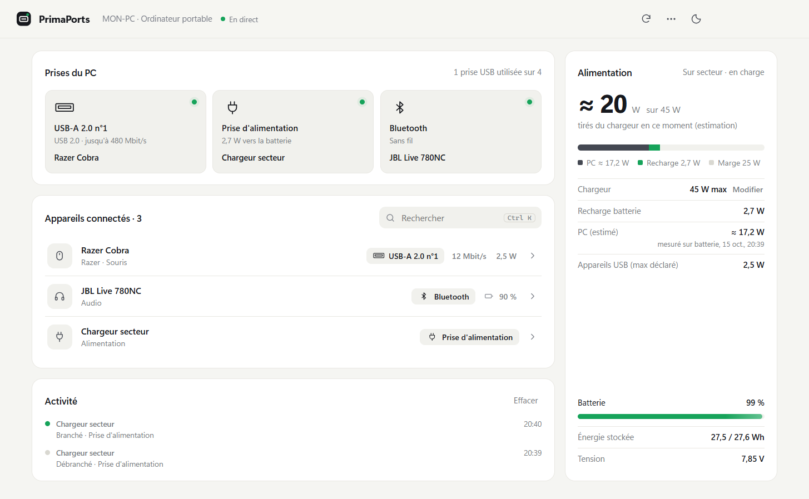
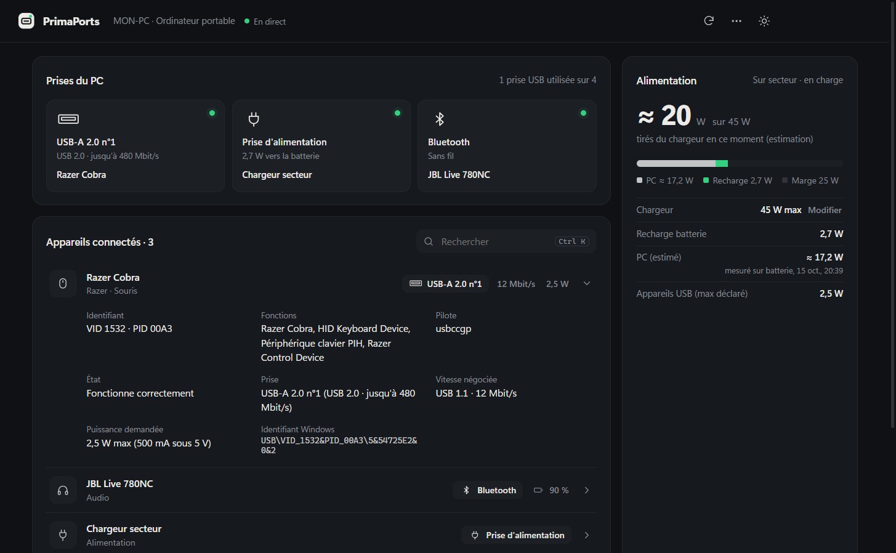

<div align="center">


# PrimaPorts

**What's plugged into your PC, into which port, and how much power it draws. In real time.**

[Français](README.md) · **English**

[](https://github.com/SkyFrostYT/PrimaPorts/releases/latest)

[](https://github.com/SkyFrostYT/PrimaPorts/releases)

### [⬇ Download PrimaPorts for Windows](https://github.com/SkyFrostYT/PrimaPorts/releases/latest)

</div>

<picture>
  <source media="(prefers-color-scheme: dark)" srcset="docs/screenshot-dark.png">
  
</picture>

> The interface is currently in French. The screenshots show the main sections: *Prises du PC* (PC ports),
> *Appareils connectés* (connected devices), *Alimentation* (power) and *Activité* (activity log).

## Why PrimaPorts?

Windows knows exactly what is plugged into your computer, but that information is scattered across
Device Manager, Bluetooth settings and power settings. PrimaPorts brings it all together in one clean
window: one glance tells you **which port is in use, by what, at what speed and at what power**.

## Features

- **PC ports**: every occupied port (USB‑A, USB‑C, HDMI, DisplayPort, audio jack, Ethernet, Bluetooth, power) with the device plugged into it.
- **Connected devices**: mice, keyboards, USB drives and disks, displays, headsets, phones… with the exact port, the negotiated speed (12 Mbit/s, 480 Mbit/s, 5 Gbit/s…) and the power each USB device requests.
- **Bluetooth**: only devices that are actually connected are shown, with their battery level when they report it.
- **Power**: power drawn from the charger, battery charging rate, PC consumption measured on battery, battery capacity and voltage.
- **Real time**: a device appears as soon as it is plugged in and disappears as soon as it is removed. The activity log keeps track of every connection.
- **Unobtrusive**: closing the window sends it to the system tray. PrimaPorts keeps watching and shows a Windows notification for every connection.
- **Handy**: start with Windows, export to CSV, JSON or text, quick search (`Ctrl K`), light or dark theme, layout that adapts to your screen size.

<div align="center">
  
  <br><sub>Device details: port, speed, power, identifiers.</sub>
</div>

## Installation

1. Download the [latest release](https://github.com/SkyFrostYT/PrimaPorts/releases/latest):
   - **`PrimaPorts-Setup-x.y.z.exe`**: installer, with Desktop and Start menu shortcuts (recommended);
   - **`PrimaPorts-x.y.z-portable.exe`**: no installation, just run it.
2. Run the file. Since the executable is not code-signed, Windows SmartScreen may show
   "Windows protected your PC": click **More info**, then **Run anyway**.

**Requirements:** Windows 10 or 11, 64-bit. No administrator rights needed.

## Usage

| Action | How |
| --- | --- |
| See a device's details | Click its row, or its port under *Prises du PC* |
| Set your charger's wattage | Power panel → *Indiquer sa puissance* |
| Measure your PC's consumption | Unplug the charger for about ten seconds |
| Export, start with Windows | **…** menu, top right |
| Rescan · Search · Zoom | `F5` · `Ctrl K` · `Ctrl +` / `Ctrl -` / `Ctrl 0` |
| Actually quit | Right-click the tray icon → *Quitter* |

## Privacy

PrimaPorts runs **entirely offline**: no internet connection, no telemetry, no account.
The activity log and settings stay on your PC, in `%APPDATA%\PrimaPorts`.

## How it works

- Devices are read through Windows interfaces (CIM/WMI and Plug and Play).
- Physical USB ports, their type (USB‑A or USB‑C), the negotiated speed and the declared power are read directly from the USB controllers, the same way Microsoft's USBView tool does.
- Windows reports every connection and every power change, and PrimaPorts updates the display immediately.
- The app is built with Electron; data collection relies on PowerShell and a small C# module.

## Good to know

- The power shown for a USB device is **the maximum it declares**, not a live measurement.
- Windows does not report the charger's wattage: you enter it once in the Power panel.
- On AC power, Windows only measures the battery charging rate, so the PC's consumption is **estimated** from measurements taken on battery.
- Only USB ports are known in advance. An HDMI, audio jack or Ethernet port only appears while it is in use.
- With a USB‑C to HDMI adapter, Windows often reports "DisplayPort".

## Building from source

Requirements: [Node.js](https://nodejs.org) 20 or later.

```bash
npm install
npm start
```

To produce the installer and the portable version in `dist/`:

```bash
npm run dist
```

| Folder / file | Purpose |
| --- | --- |
| `app/` | Electron app: window, tray icon, notifications, collection engine and activity log. |
| `ui/` | User interface (HTML, CSS, JavaScript). |
| `collector/collect.ps1` | Device inventory through Windows (CIM/WMI, Plug and Play). |
| `collector/UsbTopology.cs` | Reads the USB controllers: ports, USB‑C, speed, power. |
| `collector/worker.ps1` · `watcher.ps1` | Long-running collector and connection event listener. |
| `build/` | Icons and the script that generates them (`python build/make-icons.py`). |
